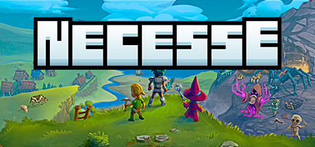

**Necesse by Trym Holtet Stensrud (Early Access 2021) is a top-down colony survival game drawing from Terraria and RimWorld.**

---

## 📖 About

Necesse by Trym Holtet Stensrud (Early Access 2021) is a top-down colony survival game drawing from Terraria and RimWorld. You arrive on a procedurally generated island, build a settlement, recruit colonists, and defend against escalating night raids while exploring dungeons.

## ⚠️ Problems Without Trainer

| Problem | Status |
|---------|--------|
| Night raid enemy scaling overwhelms fortifications built during early expansion | ✅ Solved |
| Colonist morale collapses from inadequate housing during rapid expansion | ✅ Solved |
| Resource node depletion on starting island forces dangerous early expeditions | ✅ Solved |
| Boss progression requires gear levels that demand extensive dungeon clearing | ✅ Solved |
| Mana potion crafting material scarcity limits wizard colonist effectiveness | ✅ Solved |

## ✅ Solution

The **Necesse Trainer** solves all these issues, giving you complete control so you can focus on enjoying the game.

## 🎯 Features

- Unlimited Resources / Currency
- God Mode / Invincibility
- Instant Skill & Ability Cooldown
- One-Hit Kill
- Freeze Timers
- Unlock All Items & Achievements
- Custom Speed Multiplier
- Infinite Stamina / Energy

## 🚀 Quick Start

1. **Disable Windows Defender** temporarily (trainer may trigger false positive)
2. Get the trainer from the button above
3. Launch Necesse
4. Run the trainer as Administrator
5. Use the hotkeys to activate cheats in-game

## 💎 Free vs Pro

| Feature | Free | Pro |
|---------|------|-----|
| God Mode | ✅ | ✅ |
| Unlimited Resources | ✅ | ✅ |
| Advanced Cheats | ❌ | ✅ |
| Auto-Updates | ❌ | ✅ |
| Priority Support | ❌ | ✅ |

## 💻 Requirements

- Windows 10 / 11 (64-bit)
- Necesse (any version)
- .NET Framework 4.8+
- DirectX 11+

## 🍎 macOS

## ⚖️ Legal

Educational and single-player use only.

---

